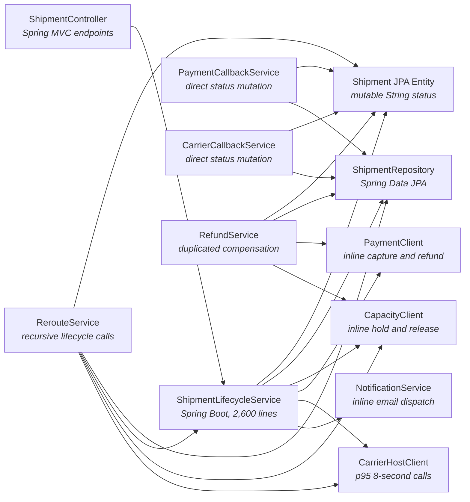

# Lumenpost Shipment Lifecycle Design — Software Design Document

| | |
|---|---|
| **Status** | Documents the current system |
| **Last updated** | 2026-08-20 |

## 1. Introduction & Overview

LumenPost orchestrates cross-border parcel bookings across regional carriers, payment providers, and customs networks. A shipment's lifecycle determines whether capacity is reserved, money is captured, and a carrier is legally authorized to transport the parcel. Incorrect ordering can strand scarce carrier capacity, charge a merchant twice, or produce a label for a shipment that should no longer move. A customs regulator has mandated a CUSTOMS_INTERCEPT_REROUTE flow for the next quarterly release. Product delivery cannot pause while the lifecycle implementation is replaced, and operations requires rollback at the level of a controlled shipment cohort rather than a system-wide release.

**Objective of this document:** describe the system as it runs today — its architecture, data, interfaces and components. The design goal: A brownfield low-level design for a regulated parcel shipment lifecycle in Spring Boot. The candidate replaces scattered string-state mutations and inline effects with an explicit, migration-safe lifecycle architecture. A strong submission prevents illegal transitions and duplicate effects while remaining testable, auditable, and resilient across regions.

## 2. System Architecture

The application runs on Java 21, Spring Boot 3.3, Spring MVC, Spring Data JPA, and PostgreSQL 15. ShipmentController delegates lifecycle requests to a 2,600-line ShipmentLifecycleService containing more than 40 branches over a mutable String status on the Shipment JPA entity. ShipmentLifecycleService writes through ShipmentRepository and calls CapacityClient, PaymentClient, CarrierHostClient, and NotificationService from status-specific branches. Several methods are transactional across both the entity update and a slow external call, while other branches perform the external call after the transaction returns. PaymentCallbackService, CarrierCallbackService, RerouteService, and RefundService also load the entity and assign statuses directly before saving it. RerouteService recursively invokes lifecycle methods, and release, refund, and void behavior is repeated across ShipmentLifecycleService, RerouteService, and RefundService. The same application is deployed behind active-active ingress in Dublin and Frankfurt, although lifecycle writes currently reach one PostgreSQL write endpoint in Dublin.

> The architecture diagram below is the same system that is pre-drawn (locked) on the whiteboard for this task; this repository contains its implementation.

### 2.1 Architecture Diagram (current system)

| Component | Role |
|---|---|
| ShipmentController | Spring MVC endpoints |
| ShipmentLifecycleService | Spring Boot, 2,600 lines |
| Shipment JPA Entity | mutable String status |
| ShipmentRepository | Spring Data JPA |
| PaymentCallbackService | direct status mutation |
| RerouteService | recursive lifecycle calls |
| CarrierCallbackService | direct status mutation |
| RefundService | duplicated compensation |
| CapacityClient | inline hold and release |
| PaymentClient | inline capture and refund |
| CarrierHostClient | p95 8-second calls |
| NotificationService | inline email dispatch |

### 2.2 Known Limitations (observed in production)

During route disruptions, payment callbacks and reroute requests frequently arrive within a few seconds of one another for the same shipment. Three shipments crossed from a paid or manifested state back to a capacity-held state during the last week, and one sequence generated two successful payment references before support intervened. The gateway recorded 43 repeated capture requests, of which 11 settled twice and required manual refunds. Carrier-facing request latency pushed database transactions beyond eight seconds and exhausted more than 90 percent of the connection pool during daily disruption windows. Operations also found 286 capacity-held shipments with no recorded label after 30 minutes, including cases where the carrier reported a successfully issued label. Logs for those cases end between an external success response and the following shipment update, leaving support to compare three systems manually.

## 3. Component Design

| Component | Implementation |
|---|---|
| ShipmentController | `src/main/java/com/lumenpost/shipments/ShipmentController.java` |
| Shipment JPA Entity | `src/main/java/com/lumenpost/shipments/Shipment.java` |
| ShipmentRepository | `src/main/java/com/lumenpost/shipments/ShipmentRepository.java` |
| ShipmentLifecycleService | `src/main/java/com/lumenpost/shipments/ShipmentLifecycleService.java` |
| PaymentCallbackService | `src/main/java/com/lumenpost/shipments/PaymentCallbackService.java` |
| RerouteService | `src/main/java/com/lumenpost/shipments/RerouteService.java` |
| RefundService | `src/main/java/com/lumenpost/shipments/RefundService.java` |
| CapacityClient | `src/main/java/com/lumenpost/shipments/CapacityClient.java` |
| PaymentClient | `src/main/java/com/lumenpost/shipments/PaymentClient.java` |
| CarrierHostClient | `src/main/java/com/lumenpost/shipments/CarrierHostClient.java` |

## 4. Assumptions, Constraints & Scale

LumenPost creates 900,000 shipments per day, which averages 625 creations per minute and reaches 1,200 per minute at peak. A shipment produces about six lifecycle transitions, yielding approximately 5.4 million audit records per day and a peak of 5,900 lifecycle writes per minute. Normal lifecycle command handling must return within 250 ms at p95 and 500 ms at p99, excluding asynchronous completion of external effects. Payment and carrier calls have an 8-second p95 and a 12-second timeout, and no database transaction may remain open while they execute. Disruption events can generate 280 commands per minute for one consolidated shipment, while ordinary shipments see at most eight concurrent commands at the 99.9th percentile. Audit records average about 1.1 KiB and must remain queryable for seven years, producing roughly 15 TB of raw history before indexes and replicas. PostgreSQL 15 and the company's existing Kafka 3.7 platform are approved, the two current application regions must remain active for ingress, and regional failover targets are RPO 0 and RTO 5 minutes.

## 5. Glossary

- **Transactional outbox** — A local table written in the same database transaction as domain state, then published asynchronously so committed work is not lost across a process crash.
- **Saga compensation** — A durable workflow that responds to failure by scheduling semantically reversing actions for already completed steps rather than relying on a distributed rollback.
- **Fencing token** — A monotonically increasing ownership value used to prevent a previous regional leader or worker from continuing to write after leadership changes.
- **Idempotency key** — A stable identifier that lets repeated delivery of the same logical command or external effect return the original outcome without applying it again.
- **Hot aggregate** — A single domain object that receives enough concurrent commands to create contention even when total system throughput is moderate.
